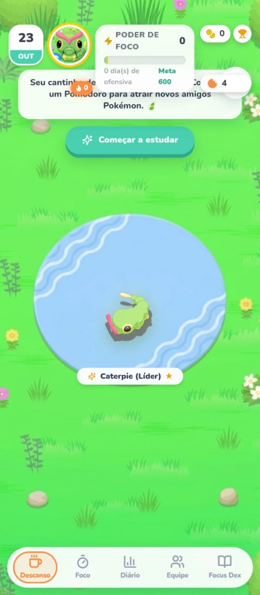

<div align="center">

  

  # 🍃 Pokémoro — Gamified Focus & Rest

  **Transforme suas sessões de estudo em descobertas Pokémon. Inspirado no Pokémon Sleep e na Técnica Pomodoro.**

  [](https://github.com/ricardolopestomaz/Pokemoro/releases/tag/v1.0.0)
  [](https://github.com/ricardolopestomaz/Pokemoro/releases/download/v1.0.0/pokemoro-v1.0.0.apk)
  [](https://react.dev/)
  [](https://supabase.com/)

  <p align="center">
    <a href="#-download-do-apk"><strong>📲 Baixar APK Oficial</strong></a> •
    <a href="#-galeria-do-aplicativo"><strong>📸 Galeria de Telas</strong></a> •
    <a href="#-principais-recursos"><strong>✨ Recursos</strong></a> •
    <a href="#-instalação-no-android"><strong>🚀 Instalação</strong></a> •
    <a href="#-desenvolvimento-local"><strong>🛠️ Desenvolvimento</strong></a>
  </p>

</div>

---

## 📲 Download do APK

Baixe a versão oficial de lançamento diretamente pelo GitHub Releases:

<div align="center">

### 👉 [**Baixar Pokémoro v1.0.0 (pokemoro-v1.0.0.apk)**](https://github.com/ricardolopestomaz/Pokemoro/releases/download/v1.0.0/pokemoro-v1.0.0.apk) 👈
*(Arquivo standalone assinado, compatível com Android 8.0 até Android 14+)*

</div>

---

## 📸 Galeria do Aplicativo

<div align="center">
  <table>
    <tr>
      <td align="center" width="50%">
        <strong>🏕️ Acampamento Greengrass (Descanso)</strong><br/><br/>
        
      </td>
      <td align="center" width="50%">
        <strong>📚 Sala de Estudos (Cenário Noturno)</strong><br/><br/>
        
      </td>
    </tr>
  </table>
</div>

---

## ✨ Principais Recursos

### 🍅 1. Pomodoro Científico com Feedback Gamificado
- Temporizador circular de foco (25 min de estudo / 5 min de descanso ou modo Livre).
- Categorização por matérias cadastradas com relatórios de horas estudadas.
- Geração de **Poder de Foco** para atrair Pokémon no Coffee Break.

### 🏕️ 2. Acampamento Zen & Descobertas
- Equipe ativa de parceiros descansando pacificamente no acampamento.
- Efeito holográfico **Balatro Foil** individual nos sprites.
- Cenários intercambiáveis: *Greengrass*, *Praia Ciano*, *Caverna Taupe*, *Tundra de Neve* e *Sala de Estudos*.

### 💬 3. Sistema de Emoções Pixeladas & Despertar
- Balões de emoção autênticos em pixel art (*Pokémon Mystery Dungeon / HeartGold*).
- **Mecânica Anti-Spam Progressiva:**
  - 1º e 2º toques: Reações carinhosas (<3, 🎵, 💤).
  - 3º toque: Irritação / Raiva (💢).
  - 4º toque: O Pokémon **acorda assustado** (❗), muda para a postura em pé e permanece acordado por 8,5 segundos suaves.
  - Ao acordar, reage com emoji apenas mais uma vez para evitar poluição sonora e visual.

### 🎨 4. UX/UI Mobile Sem Poluição
- Eliminação de caixas brancas estáticas sobre a grama.
- **Revelação Contextual:** Nomes e níveis deslizam suavemente sob o Pokémon apenas quando ele é tocado.
- Insígnia discreta em vidro escuro com estrela dourada para o Líder da Equipe.
- Otimização rigorosa para processadores móveis (Mali-G52, Adreno) sem congelamento de tela no Android 14 / Xiaomi HyperOS.

### ⚡ 5. Arquitetura Híbrida Offline-First
- Armazenamento local ultra-rápido com IndexedDB / LocalStorage.
- Fila de sincronização resiliente que despacha dados para o Supabase quando há conexão com a internet.
- Zero perda de dados se o sinal oscilar durante uma sessão de estudo.

---

## 🚀 Instalação no Android

1. Acesse o link de [Download do APK](https://github.com/ricardolopestomaz/Pokemoro/releases/download/v1.0.0/pokemoro-v1.0.0.apk) no seu celular.
2. Abra o arquivo baixado `pokemoro-v1.0.0.apk`.
3. Se o Android solicitar permissão para *"Instalar aplicativos de fontes desconhecidas"*, clique em **Configurações** e autorize o navegador/gerenciador de arquivos.
4. Toque em **Instalar** e pronto! Abra o Pokémoro e comece sua jornada de foco.

---

## 🛠️ Desenvolvimento Local

### Pré-requisitos
- [Node.js](https://nodejs.org/) v18 ou superior
- [npm](https://www.npmjs.com/)
- [Android Studio](https://developer.android.com/studio) (para compilar nativamente o APK)

### Passo a Passo

```bash
# 1. Clonar o repositório
git clone https://github.com/ricardolopestomaz/Pokemoro.git
cd Pokemoro

# 2. Instalar dependências do Frontend
cd frontend
npm install

# 3. Executar em modo de desenvolvimento web
npm run dev

# 4. Rodar a suíte de testes automatizados (16 arquivos / 93 testes)
npm test -- --run

# 5. Compilar o bundle de produção e sincronizar com o Android
npm run build
npx cap sync android

# 6. Compilar o APK Android Debug via Gradle
cd android
.\gradlew.bat assembleDebug
```

O binário compilado estará localizado em:
`frontend/android/app/build/outputs/apk/debug/app-debug.apk`.

---

## 🗂️ Estrutura do Projeto

```text
Pokemoro/
├── assets/                  # Artes, cenários, ícones e capturas de tela
│   └── screenshots/         # Prints oficiais do app para o README
├── backend/                 # API Node.js / Express com SQLite e regras de spawn
├── frontend/                # SPA React 18, TypeScript, Tailwind CSS e Capacitor
│   ├── android/             # Projeto nativo Android com Capacitor
│   ├── public/              # Assets estáticos, sprites e balões pixelados
│   └── src/                 # Componentes, hooks, testes Vitest e engine de foco
├── supabase/                # Migrações SQL e esquemas de dados da nuvem
├── pokemoro-v1.0.0.apk       # APK oficial de lançamento
└── README.md                # Documentação completa do projeto
```

---

## 📜 Licença e Créditos

- Desenvolvido por **Ricardo Lopes Tomaz** e comunidade.
- Pokémon e Pokémon Sleep são marcas registradas da **Nintendo / Creatures Inc. / GAME FREAK inc.**
- Projeto de cunho educacional e de produtividade pessoal sob a licença [MIT](LICENSE).
